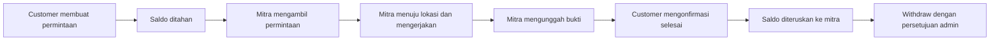

<div align="center">

# 🤝 SayaBantu

### Bantuan sosial, lebih dekat dan terkoordinasi.

Platform yang menghubungkan **customer** yang membutuhkan bantuan dengan **mitra** yang siap membantu—dengan proses verifikasi, pemantauan, dan pengelolaan dana oleh admin.

<br>


</div>

---

## Tentang proyek

SayaBantu adalah aplikasi web **mobile-first** untuk mengelola layanan bantuan sosial on-demand. Customer membuat permintaan, mitra menangani pesanan, dan admin wilayah bersama super admin mengelola verifikasi, moderasi, serta pencairan dana.

Antarmuka dirancang dengan lebar maksimum 420 px dan navigasi bawah agar nyaman digunakan melalui ponsel.

## Peran dalam aplikasi

| Peran | Tanggung jawab utama |
|---|---|
| **Customer** | Mendaftar, menyelesaikan onboarding, membuat permintaan, berkomunikasi dengan mitra, dan mengonfirmasi pekerjaan |
| **Mitra** | Melengkapi verifikasi, mengambil permintaan, memperbarui perjalanan, dan mengunggah bukti pekerjaan |
| **Admin wilayah** | Memeriksa pendaftaran dan KTP, mengelola transaksi, serta memoderasi aktivitas |
| **Super admin** | Mengelola operasional dan pengawasan lintas wilayah |

## Fitur utama

- **Akun dan verifikasi:** registrasi, verifikasi email, login dengan email atau nomor HP, Google OAuth, dan onboarding KTP.
- **Permintaan bantuan:** permintaan terjadwal atau urgent, pembatalan otomatis, dan pelacakan perjalanan mitra berbasis GPS (termasuk simulasi).
- **Komunikasi dan akuntabilitas:** chat customer–mitra, rating dua arah, laporan pelanggaran, dan sanksi.
- **Pengelolaan saldo:** penahanan saldo, top up dengan bukti transfer dan persetujuan, serta withdraw dengan persetujuan admin.
- **Operasional admin:** panel admin wilayah dan super admin, activity log, serta ekspor transaksi ke Excel.
- **Otomasi:** konfirmasi otomatis setelah 24 jam dan pembatalan permintaan kedaluwarsa melalui scheduler.

> **Catatan integrasi pembayaran:** Midtrans saat ini tercatat sebagai kolom yang tersedia pada `balance_transactions`; jangan menganggap pembayaran Midtrans sudah aktif tanpa konfigurasi dan implementasi tambahan.

## Alur permintaan bantuan



Status bantuan yang digunakan aplikasi:

```text
menunggu_mitra → memperoleh_mitra → partner_on_the_way → partner_arrived
→ in_progress → waiting_customer_confirmation → selesai
                                          └──────────→ dibatalkan / rejected
```

Nilai status lama (`approved`, `taken`, `completed`, `cancelled`, `pending`) tetap dikenali melalui `HelpStatus::aliases()` dan telah dinormalkan oleh migration.

## Teknologi

| Area | Teknologi |
|---|---|
| Backend | PHP 8.2+, Laravel 12 |
| UI dan frontend | Livewire 3, Volt, Alpine.js, Tailwind CSS, Vite |
| Autentikasi | Laravel Breeze, verifikasi email, Google OAuth (Socialite) |
| Database | MySQL 8 / MariaDB untuk penggunaan aplikasi; SQLite in-memory untuk test |
| Pembayaran | Kolom Midtrans tersedia di `balance_transactions` (lihat catatan integrasi di atas) |

## Menjalankan secara lokal

### Persyaratan

- PHP 8.2+ dengan ekstensi `pdo`, `mbstring`, `gd`, dan `fileinfo`
- Composer 2
- Node.js 18+ dan npm
- MySQL 8 atau MariaDB

### Instalasi

1. Pasang dependency:

   ```bash
   composer install
   npm install
   ```

2. Buat file environment dan application key:

   ```bash
   cp .env.example .env
   php artisan key:generate
   ```

3. Isi koneksi database di `.env` (`DB_DATABASE`, `DB_USERNAME`, `DB_PASSWORD`). Tambahkan kredensial Google OAuth bila diperlukan.

4. Siapkan database, storage, dan aset:

   ```bash
   php artisan migrate --seed
   php artisan storage:link
   npm run build
   ```

5. Jalankan aplikasi:

   ```bash
   php artisan serve
   ```

   Buka [http://127.0.0.1:8000](http://127.0.0.1:8000).

Untuk lingkungan development, `composer dev` menjalankan server Laravel, listener queue, scheduler, log, dan Vite secara bersamaan. Queue worker saat ini belum dibutuhkan oleh fitur notifikasi karena notifikasi dikirim sinkron; listener queue yang dimulai oleh skrip tersebut disediakan untuk kebutuhan development.

### Akun uji onboarding

Seeder `database/seeders/UserSeeder.php` membuat akun berikut dengan password `Sayabantu123!`. Akun berstatus `active`, tetapi `is_completed = false`, sehingga login akan diarahkan ke langkah onboarding yang belum selesai.

| Email | Peran | Tahap onboarding |
|---|---|---|
| `customer.onboarding@sayabantu.com` | Customer | `onboarding/step1` (NIK belum diisi) |
| `customer.pending@sayabantu.com` | Customer | `onboarding/step2` (unggah KTP) |
| `mitra.pending@sayabantu.com` | Mitra | `onboarding/step2` (unggah KTP) |
| `yusuf.mitra@test.com` | Mitra | `onboarding/step2` (unggah KTP) |

Dua akun mitra juga memiliki entri `registrations` berstatus `pending_verification` untuk menguji antrean verifikasi KTP di panel admin.

> Akun dan password ini untuk pengembangan/testing lokal saja. Jangan gunakan akun seeder atau password yang sama di production.

### Login demo

`DEMO_LOGIN=true` mengaktifkan toleransi password demo (`Sayabantu123!`, `sayabantu123`, atau `password`) bagi akun yang memang menggunakan salah satu password tersebut. Nilai default di `.env.example` adalah `false`. **Jangan aktifkan fitur ini di production.**

## Scheduler dan proses background

Scheduler harus aktif agar tugas otomatis berjalan. Saat development gunakan:

```bash
php artisan schedule:work
```

Di server, daftarkan cron untuk menjalankan scheduler setiap menit:

```cron
* * * * * cd /path/to/sayabantu && php artisan schedule:run >> /dev/null 2>&1
```

Scheduler menjalankan `helps:auto-confirm` setiap 10 menit dan `helps:auto-cancel` setiap menit. Queue worker belum dibutuhkan untuk notifikasi saat ini. Jika kelak job menggunakan `ShouldQueue`, jalankan worker dengan `php artisan queue:work`.

## Testing

Test menggunakan SQLite in-memory melalui `phpunit.xml`, jadi tidak mengubah database MySQL lokal.

```bash
php artisan test
php artisan test tests/Feature/Smoke
```

Cakupan test meliputi autentikasi, verifikasi email, registrasi multi-step, profil, alur saldo dan withdraw, normalisasi status, serta smoke test halaman utama per role.

## Perintah berguna

```bash
php artisan route:list                # Daftar route
php artisan schedule:list             # Jadwal aktif
php artisan helps:auto-cancel         # Jalankan pembatalan order kedaluwarsa
php artisan helps:auto-confirm        # Jalankan konfirmasi otomatis
php artisan config:clear && php artisan cache:clear && php artisan view:clear
```

## Struktur proyek

```text
app/
├── Enums/HelpStatus.php              Sumber nilai status bantuan dan alias legacy
├── Models/Help.php                   Model inti transaksi bantuan
├── Models/Concerns/                  Trait status, timeline, payout, dan pembatalan mitra
├── Livewire/                         Komponen customer, mitra, admin, dan super admin
├── Observers/HelpObserver.php        Efek perubahan status, refund, dan pencairan saldo
├── Support/                          Utilitas master wilayah dan SQL lintas driver
└── Console/Commands/                 Perintah bantuan dan maintenance

routes/                               Route publik, autentikasi, dan per role
database/migrations/                  Skema dan perubahan database
scripts/                              Skrip utilitas manual; lihat scripts/README.md
```

## Status pengembangan

**Tersedia:** autentikasi dan onboarding, verifikasi KTP manual, alur permintaan bantuan, tracking mitra, chat, rating, laporan pelanggaran, saldo/top up/withdraw, panel admin, activity log, dan ekspor transaksi Excel.

**Belum tersedia:** notifikasi real-time (Pusher/Laravel Echo), push notification, verifikasi KTP otomatis (OCR), dan ekspor laporan PDF.

## Catatan keamanan dan operasional

- Production wajib menggunakan `APP_DEBUG=false`; nilai default di `.env.example` adalah `false`.
- Jangan aktifkan `DEMO_LOGIN` di production dan jangan gunakan kredensial seeder di production.
- Log menggunakan channel `daily` (`LOG_STACK=daily`) dengan retensi 14 hari.
- Aplikasi ini dibuat untuk tujuan pembelajaran dan sosial.

---

<div align="center">

Dibangun dengan Laravel dan Livewire.

</div>
