<div align="center">

# 🤝 SayaBantu

### Bantuan sosial, lebih dekat dan terkoordinasi.

**Satu platform untuk menghubungkan orang yang membutuhkan bantuan dengan mitra yang siap membantu.**

Customer mengajukan permintaan · Mitra membantu · Admin menjaga proses tetap terverifikasi

<br>


</div>

---

## Mengapa SayaBantu?

Mengelola bantuan sosial membutuhkan koordinasi yang jelas antara penerima bantuan, mitra lapangan, dan admin. **SayaBantu menyatukan alur tersebut dalam satu aplikasi**—dari pendaftaran dan verifikasi, permintaan bantuan, pelacakan pekerjaan, hingga pengelolaan saldo.

Aplikasi dibuat sebagai web app **mobile-first** dengan lebar antarmuka maksimum 420 px dan navigasi bawah, sehingga alur utama nyaman digunakan dari ponsel.

## Cara kerja

```mermaid
flowchart LR
    A[Customer daftar dan diverifikasi] --> B[Ajukan permintaan bantuan]
    B --> C[Saldo ditahan]
    C --> D[Mitra menerima permintaan]
    D --> E[Perjalanan dan pengerjaan]
    E --> F[Bukti pekerjaan diunggah]
    F --> G[Customer mengonfirmasi]
    G --> H[Saldo diteruskan ke mitra]
    H --> I[Withdraw dengan persetujuan admin]
```



## Untuk siapa?

| Peran | Yang dapat dilakukan |
|---|---|
| **Customer** | Menyelesaikan onboarding, membuat permintaan, berkomunikasi dengan mitra, dan mengonfirmasi pekerjaan |
| **Mitra** | Melengkapi verifikasi, mengambil permintaan, memperbarui perjalanan, dan mengunggah bukti pekerjaan |
| **Admin wilayah** | Memverifikasi pendaftaran/KTP, memoderasi aktivitas, dan menyetujui transaksi |
| **Super admin** | Memantau dan mengelola operasional lintas wilayah |

## Fitur

- **Akun terverifikasi** — registrasi, verifikasi email, login dengan email atau nomor HP, Google OAuth, dan onboarding KTP.
- **Permintaan fleksibel** — bantuan terjadwal maupun urgent, dengan pembatalan otomatis untuk permintaan kedaluwarsa.
- **Pelacakan pekerjaan** — status perjalanan mitra, GPS (termasuk simulasi), chat, serta unggah bukti.
- **Kepercayaan dan keamanan** — rating dua arah, laporan pelanggaran, sanksi, dan verifikasi manual oleh admin.
- **Pengelolaan dana** — penahanan saldo, top up dengan bukti transfer dan persetujuan, serta withdraw dengan persetujuan admin.
- **Perangkat operasional** — panel admin wilayah dan super admin, activity log, serta ekspor transaksi ke Excel.
- **Otomasi** — konfirmasi otomatis setelah 24 jam dan pembatalan otomatis melalui scheduler.

> **Status pembayaran:** Midtrans belum dinyatakan sebagai integrasi pembayaran aktif. Saat ini informasi yang tersedia adalah kolom Midtrans pada `balance_transactions`.

## Status bantuan

```text
menunggu_mitra → memperoleh_mitra → partner_on_the_way → partner_arrived
→ in_progress → waiting_customer_confirmation → selesai
                                          └──────────→ dibatalkan / rejected
```

Nilai lama (`approved`, `taken`, `completed`, `cancelled`, `pending`) tetap dikenali melalui `HelpStatus::aliases()` dan telah dinormalkan oleh migration.

## Teknologi

| Area | Teknologi |
|---|---|
| Backend | PHP 8.2+, Laravel 12 |
| Antarmuka | Livewire 3, Volt, Alpine.js, Tailwind CSS, Vite |
| Autentikasi | Laravel Breeze, verifikasi email, Google OAuth (Socialite) |
| Database | MySQL 8 / MariaDB; SQLite in-memory untuk test |

## Mulai di komputer lokal

### Yang dibutuhkan

- PHP 8.2+ dengan ekstensi `pdo`, `mbstring`, `gd`, dan `fileinfo`
- Composer 2
- Node.js 18+ dan npm
- MySQL 8 atau MariaDB

### Instalasi

```bash
# Pasang dependency
composer install
npm install

# Siapkan konfigurasi dan application key
cp .env.example .env
php artisan key:generate
```

Atur `DB_DATABASE`, `DB_USERNAME`, dan `DB_PASSWORD` di `.env`. Tambahkan kredensial Google OAuth bila ingin memakai login Google.

```bash
# Siapkan database, storage, dan aset
php artisan migrate --seed
php artisan storage:link
npm run build

# Jalankan aplikasi
php artisan serve
```

Buka [http://127.0.0.1:8000](http://127.0.0.1:8000).

Untuk development, `composer dev` menjalankan server Laravel, listener queue, scheduler, log, dan Vite secara bersamaan. Notifikasi saat ini dikirim sinkron; queue worker belum dibutuhkan oleh fitur notifikasi.

### Akun uji onboarding

Seeder `database/seeders/UserSeeder.php` membuat akun berikut. Password semua akun adalah `Sayabantu123!`. Akun berstatus `active`, tetapi `is_completed = false`, sehingga login mengarahkan pengguna ke tahap onboarding yang belum selesai.

| Email | Peran | Tujuan setelah login |
|---|---|---|
| `customer.onboarding@sayabantu.com` | Customer | `onboarding/step1` (NIK belum diisi) |
| `customer.pending@sayabantu.com` | Customer | `onboarding/step2` (unggah KTP) |
| `mitra.pending@sayabantu.com` | Mitra | `onboarding/step2` (unggah KTP) |
| `yusuf.mitra@test.com` | Mitra | `onboarding/step2` (unggah KTP) |

Dua akun mitra memiliki entri `registrations` berstatus `pending_verification` untuk mencoba antrean verifikasi KTP di panel admin.

> **Lokal saja:** akun seeder dan password tersebut hanya untuk development/testing. Jangan gunakan di production.

### Login demo

`DEMO_LOGIN=true` mengaktifkan toleransi password demo (`Sayabantu123!`, `sayabantu123`, atau `password`) bagi akun yang memang memakai salah satu password tersebut. Nilai default di `.env.example` adalah `false`. **Jangan aktifkan di production.**

## Scheduler

Scheduler harus aktif untuk menjalankan tugas otomatis. Saat development:

```bash
php artisan schedule:work
```

Di server, tambahkan cron berikut agar scheduler dijalankan setiap menit:

```cron
* * * * * cd /path/to/sayabantu && php artisan schedule:run >> /dev/null 2>&1
```

Jadwal aplikasi menjalankan `helps:auto-confirm` setiap 10 menit dan `helps:auto-cancel` setiap menit. Queue worker belum dibutuhkan untuk notifikasi saat ini. Jika kelak job menggunakan `ShouldQueue`, jalankan `php artisan queue:work`.

## Testing

Test menggunakan SQLite in-memory dari `phpunit.xml`, sehingga tidak mengubah database MySQL lokal.

```bash
php artisan test
php artisan test tests/Feature/Smoke
```

Cakupan meliputi autentikasi, verifikasi email, registrasi multi-step, profil, saldo dan withdraw, normalisasi status, serta smoke test halaman utama per role.

## Perintah berguna

```bash
php artisan route:list                # Daftar route
php artisan schedule:list             # Jadwal aktif
php artisan helps:auto-cancel         # Jalankan pembatalan order kedaluwarsa
php artisan helps:auto-confirm        # Jalankan konfirmasi otomatis
php artisan config:clear && php artisan cache:clear && php artisan view:clear
```

## Struktur proyek

```text
app/
├── Enums/HelpStatus.php              Status bantuan dan alias legacy
├── Models/Help.php                   Model inti transaksi bantuan
├── Models/Concerns/                  Trait status, timeline, payout, pembatalan mitra
├── Livewire/                         Komponen customer, mitra, admin, super admin
├── Observers/HelpObserver.php        Efek perubahan status, refund, pencairan saldo
├── Support/                          Utilitas master wilayah dan SQL lintas driver
└── Console/Commands/                 Perintah bantuan dan maintenance

routes/                               Route publik, autentikasi, dan per role
database/migrations/                  Skema dan perubahan database
scripts/                              Skrip utilitas manual; lihat scripts/README.md
```

## Roadmap

**Sudah tersedia:** autentikasi dan onboarding, verifikasi KTP manual, alur permintaan bantuan, tracking mitra, chat, rating, laporan pelanggaran, saldo/top up/withdraw, panel admin, activity log, dan ekspor transaksi Excel.

**Belum tersedia:** notifikasi real-time (Pusher/Laravel Echo), push notification, verifikasi KTP otomatis (OCR), dan ekspor laporan PDF.

## Keamanan dan operasional

- Gunakan `APP_DEBUG=false` di production; nilai default di `.env.example` adalah `false`.
- Jangan aktifkan `DEMO_LOGIN` atau gunakan kredensial seeder di production.
- Log menggunakan channel `daily` (`LOG_STACK=daily`) dengan retensi 14 hari.
- Aplikasi ini dibuat untuk tujuan pembelajaran dan sosial.

---

<div align="center">

**SayaBantu — teknologi untuk membantu, dengan proses yang lebih terkoordinasi.**

</div>
